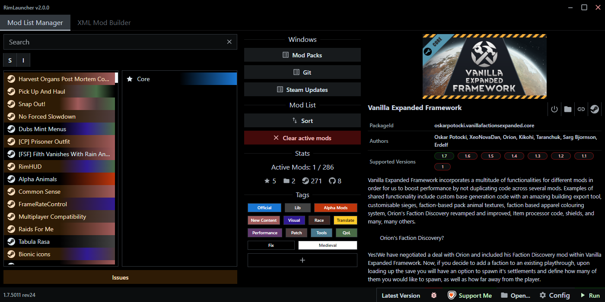

<h1 align="center">RimLauncher</h1>

  
  
  

  
  

  
  
  

  

---

## ⚠️ Security Notice

> RimLauncher is currently not code-signed or notarized.
> Your operating system may display a security warning when launching the application for the first time.

| macOS | Windows |
|-------|---------|
| **Message:** Apple could not verify the app.   **Fix:** Right-click the app → Open → Confirm. | **Message:** Windows protected your PC.   **Fix:** More info → Run anyway. |

Only download RimLauncher from the official [GitHub Releases](https://github.com/Inadequado4192/RimLauncher/releases) page.

---

## 🔍 About

RimLauncher is a desktop application designed to simplify RimWorld mod management.

It provides tools to organize mods, manage modpacks, track updates, and download mods directly from Git repositories — all in one place.

---

## 🚀 Installation

1. Download the latest version from [GitHub Releases](https://github.com/Inadequado4192/RimLauncher/releases).
2. Choose the installer for your operating system.
3. Run the installer and follow the instructions.

---

## ⚙️ Features

- 🔄 Enable or disable installed mods
- 🧩 Download and update mods from Git repositories
- 📜 View Steam mod update history
- 📦 Create and manage modpacks
- 🏷️ Organize mods using custom tags
- ✅ Import and export modpacks

➡️ See [ROADMAP.md](./ROADMAP.md) for planned features.

---

## ℹ️ Compatibility

RimLauncher may work with unofficial or modified copies of RimWorld, but these configurations are not tested or officially supported.

For the best compatibility, we recommend using the official version of RimWorld.

---

## 📦 Changelog
Check out all updates, fixes, and improvements in the [CHANGELOG.md](./CHANGELOG.md).
